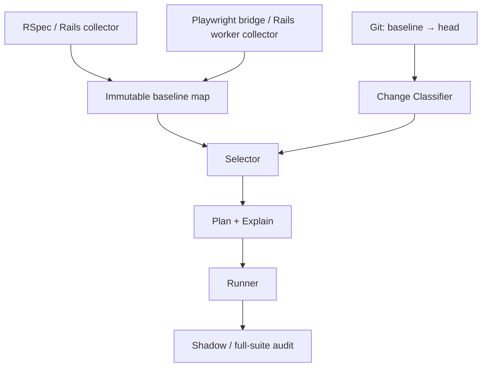

# sabun: Ruby / Rails 差分テスト選択 gem 設計

状態: 設計提案（未実装） / 2026-10-17

## 1. 目的と原則

変更されたコードの影響を受けるテストを選び、全件実行と比べた総CI時間を削減する。RSpec request/system spec と Playwright E2E を共通の選択エンジンで扱う。

**「影響を確認できなかったテストを除外する」のではなく、「今回も結果を再利用できる根拠のあるテストだけを除外する」。**

完全な同値性の証明はできない。計測欠損、動的な依存、共有状態、環境差分を検出した場合は対象を広げ、範囲を確定できなければ全件実行する。異なる種類のテストは相互の代替にしない。

初版の選択単位は RSpec が spec ファイル、Playwright が test ファイル × project。細粒度化は測定で効果がある場所だけに限定する。

## 2. 全体構成



- **Change Classifier**: 変更前後のファイル・構文・構造・資産を分類。解析できない変更は未知として扱う。
- **Collectors**: 実行時の依存を、テストID・対象コード・計測条件・完全性とともに記録。
- **Map Store**: 信頼できる全件実行から作る不変マップ。失敗途中の観測で正常な記録を上書きしない。
- **Selector**: 変更と逆引き索引から候補を選び、未知の依存や構造変更による拡大を適用。
- **Planner / Explain**: テストごとに「選択」「省略」「安全側への拡大」の根拠を機械可読JSONで返す。
- **Runner**: ランナー別アダプターで計画を実行。初期導入は選択結果を記録しつつ全件実行する shadow mode。

gemはCI・DB・ブラウザーのプロビジョニングを引き受けない。E2EのTypeScript側は最小のbridgeを同一リポジトリで提供する。

## 3. 省略の必要条件

あるテスト単位を省略するには、すべてを満たす必要がある。

1. 登録済みスイートで、前回の全件実行から得た完全な依存記録がある。
2. 依存記録が観測したコードのcommitと、今回のheadが識別できる。比較対象は**mapを作ったcommit**であり、PRのmerge-baseだけではない。
3. Ruby・依存パッケージ・Rails初期化・テスト設定・Feature Flag・locale・ブラウザー・資産ビルドなど、記録の適用条件が一致するか、変更として解析されている。
4. 今回の変更と依存の交差がなく、構造変更や未観測の入口から影響する可能性もないと判定できる。
5. テスト間の共有状態・非同期処理・別プロセスの計測が、サポートする分離契約を満たす。
6. 新規テスト・削除済みテスト・計測不完全なテストを、空の依存集合として誤解していない。

いずれか不明なら、確実に限定できるスイートまで拡大し、それも無理なら全件実行する。利用者の明示的な危険モードを通常のCIの既定値にしない。

## 4. 変更分類と選択

| 変更 | 初版の動作 |
| --- | --- |
| 既存の通常メソッド本体だけの変更 | 当該ファイルの実行依存を持つテスト |
| メソッド追加・削除、継承、include/prepend、callback、validation、関連定義 | 対象Rubyアプリの登録スイート全体（限定的な構造依存の実装後に縮小） |
| Rubyファイルの新規追加・削除、解析不能 | 関係するスイート全体 |
| 既存テンプレート・partial | 利用したテスト。探索候補変更や計測欠損なら描画系全体 |
| routes、initializer、schema、Factory、共有フック | 登録された影響スイートへ拡大。境界不明なら全件 |
| JS/CSSソース | ビルド時のソース→資産とE2Eの読み込み資産を結合。未対応・不明ならsystem/E2E全体 |
| lockfile、Ruby/ブラウザー/テスト実行条件 | 適用条件の不一致として全件または対象スイート全体 |
| 新規・変更されたテスト | 常に実行 |

既存メソッド本体だけの変更かどうかは Prism AST と変更前後の位置情報で保守的に判定する。行番号そのものを永続IDにしない。追加された行は過去の実行履歴を持たないため、所属メソッド全体の変更として扱う。

**選択集合 = 実行依存の交差 ∪ 構造・資産依存 ∪ 新規/変更テスト ∪ 安全に除外できないテスト。**

逆引き索引は `dependency_key → test_unit_ids`。最初は通常のHash/Setで実装し、索引処理がボトルネックと判明した場合のみBitsetなどへ変更する。

## 5. Ruby / Rails 計測

- Ruby `Coverage` のlines/methodsをアプリのロード前に開始し、ロード・定義・実行を区別する。
- example前後のカウンター差分から実行依存を収集する。ただし標準Coverageは**プロセス全体**の値であり、並列テストの帰属を保証しない。
- 起動時、共有before/after、suite/contextの処理、遅延autoloadは共通依存として扱う。初回exampleへだけ帰属させない。
- RSpecのセットアップ/後処理、Factory生成、request処理、描画を選択単位へ帰属させる。
- `ActiveSupport::Notifications` のcontroller、template/partial、jobなどのイベントを補助依存として記録する。通知だけで全依存が取れると仮定しない。
- Coverageの `oneshot_lines` をテストごとにclearして再利用しない。繰り返し実行行が再記録されないため。
- SimpleCovや別のCoverage利用者との競合をdoctorで検出し、保証できない構成では細粒度の省略を許可しない。

起動時にロードされたすべてのRubyファイルを、全テストの「メソッド実行依存」として扱わない。ただし起動時に実行された処理の副作用は共有依存として保持する。

## 6. E2E計測と並列実行

初版では **workerごとにRails・job・DB/cacheの名前空間を分離**し、同一worker内では同時に複数のテスト単位を実行しない。Railsはworker内で再利用してよいが、各テストの初期状態を再現可能にする。

Playwright bridgeは `testId / project / workerIndex / parallelIndex / retry / run generation` と対応するRails workerへ送る識別子を管理する。ブラウザーから管理対象のRailsへ送るリクエストと、そこから発生したjobの依存を同じテストへ帰属させる。外部サービスに識別ヘッダーを漏らさない。

テスト間とsuite終了時のRails依存は、workerの終了時に最終Coverage snapshotを取得してE2E suite共通の依存へ集約する。最終snapshotがないworkerは記録不完全としてbaselineへ昇格させない。このためrecord中のRails workerはPlaywright suite終了後に正常終了する必要がある。

HTTP応答終了だけでは観測を閉じず、必要なjobの完了・失敗・再試行・追跡欠損を判定する。ジョブ完了を追えない場合はそのテストの依存マップを不完全として扱う。worker再起動時にはrun generationを更新し、旧workerのイベント混入を防ぐ。

URL/controllerの対応は補助索引であり、別の入力条件で通ったrequest specの依存をE2Eへコピーして済ませない。

JS/CSSはまずビルド依存の資産単位で選択する。過去にマッチしなかったCSSセレクターや未実行JS行だけを根拠に除外しない。PlaywrightのChromium限定Coverageは初版の必須条件にしない。

## 7. マップとプロトコル

```json
{
  "schema_version": 1,
  "baseline": {
    "repository": "app",
    "commit": "<full commit sha>",
    "environment_fingerprint": "<digest>"
  },
  "units": [
    {
      "id": "rspec:spec/requests/orders_spec.rb",
      "kind": "rspec_file",
      "complete": true,
      "dependencies": [
        "ruby:file:app/controllers/orders_controller.rb",
        "rails:template:orders/show"
      ]
    }
  ]
}
```

例示スキーマであり、実装時に厳密なJSON Schemaを固定する。テストIDはスイート・project・リポジトリを含めて衝突しない形にする。E2Eが別リポジトリの場合、各リポジトリのcommitと資産manifestも保持する。

保存はアトミックに行い、schema versionと観測完了状態を検証する。選択実行の部分マップを全件実行済みのbaselineとして昇格させない。未知のschemaは空マップとして扱わず、選択を無効化する。

## 8. CLI案

```bash
bundle exec sabun doctor
bundle exec sabun record --all --out tmp/sabun/baseline
bundle exec sabun plan --baseline tmp/sabun/baseline --head HEAD --out tmp/sabun/plan.json
bundle exec sabun explain --plan tmp/sabun/plan.json
bundle exec sabun run --plan tmp/sabun/plan.json
```

gem名はリポジトリ名に合わせて `sabun` とする案。実際のCLI/APIは未実装。doctorは対応するRuby/Rails/RSpec/ブラウザー構成、Coverage競合、分離・job追跡の能力を報告する。

`plan.json` は各テストの実行/省略理由、適用した安全側への拡大、マップ・コードの識別情報を持つ。CIの実行環境で不一致が発生した場合、計画をそのまま強制実行せず安全側へ戻す。

## 9. 実装の段階

1. **基盤**: gemspec、CLI、バージョン付きマップ、baseline/head比較、完全性チェック、説明可能なプラン。変更の分類不能時は全件実行。
2. **RSpec/Rails**: ファイル単位CoverageとRSpec統合、起動/共有依存、Rails通知、単独実行と全件実行の一致検証。
3. **変更分類**: Prismで既存メソッド本体だけを保守的に識別。構造変更・新規ファイル・テスト設定変更の拡大。
4. **E2E**: worker分離、Playwright bridge、Rails/job帰属、JS/CSS資産依存、worker再起動/異常終了対応。
5. **選択精度の改善**: 実測で過剰選択が多い領域だけメソッド粒度に移行。マップ増分更新は安全性検証後。

初版から汎用的なRuby静的呼び出しグラフ、AIによる省略、DB行単位追跡、全イベントの分散トレーシングは作らない。

## 10. 検証・受け入れ基準

- 同じ入力条件での全件実行と選択実行を照合するshadow modeを提供する。
- 既存メソッド本体変更、空メソッドへの処理追加、callback/継承/route/template追加、Factory、共有フック、Feature Flag、schema、JS/CSSの新規適用をfixtureで検証する。
- E2Eはworker並列、retry、worker再起動、非同期jobの成功/失敗/追跡欠損、キャッシュの共有を検証する。
- 欠損マップ、未知schema、環境fingerprint不一致、未登録スイート、Git差分取得失敗は**テスト0件**を返さない。
- テスト失敗捕捉率と、不具合を含む変更の検出率を分けて計測する。削減率だけで採用を判断しない。
- 計測/選択/起動/監査を含む総CI時間と、PRでの待ち時間を比較する。目標値は実測から設定する。

shadow modeの観測後に限定導入し、定常運用でも無作為・重点対象の全件監査を継続する。全件監査を減らす場合は、選択漏れの発見が遅れるリスクを明示する。

## 11. 参考資料

- Ruby Coverage: https://docs.ruby-lang.org/en/3.3/Coverage.html
- Ruby TracePoint: https://docs.ruby-lang.org/en/3.3/TracePoint.html
- Rails Instrumentation: https://guides.rubyonrails.org/active_support_instrumentation.html
- Rails Autoloading: https://guides.rubyonrails.org/autoloading_and_reloading_constants.html
- RSpec Hooks: https://rspec.info/features/3-13/rspec-core/hooks/around-hooks/
- Playwright Parallelism: https://playwright.dev/docs/test-parallel
- Playwright Coverage: https://playwright.dev/docs/api/class-coverage
- Prism: https://ruby.github.io/prism/rb/docs/ruby_api_md.html
- Git diff: https://git-scm.com/docs/git-diff
